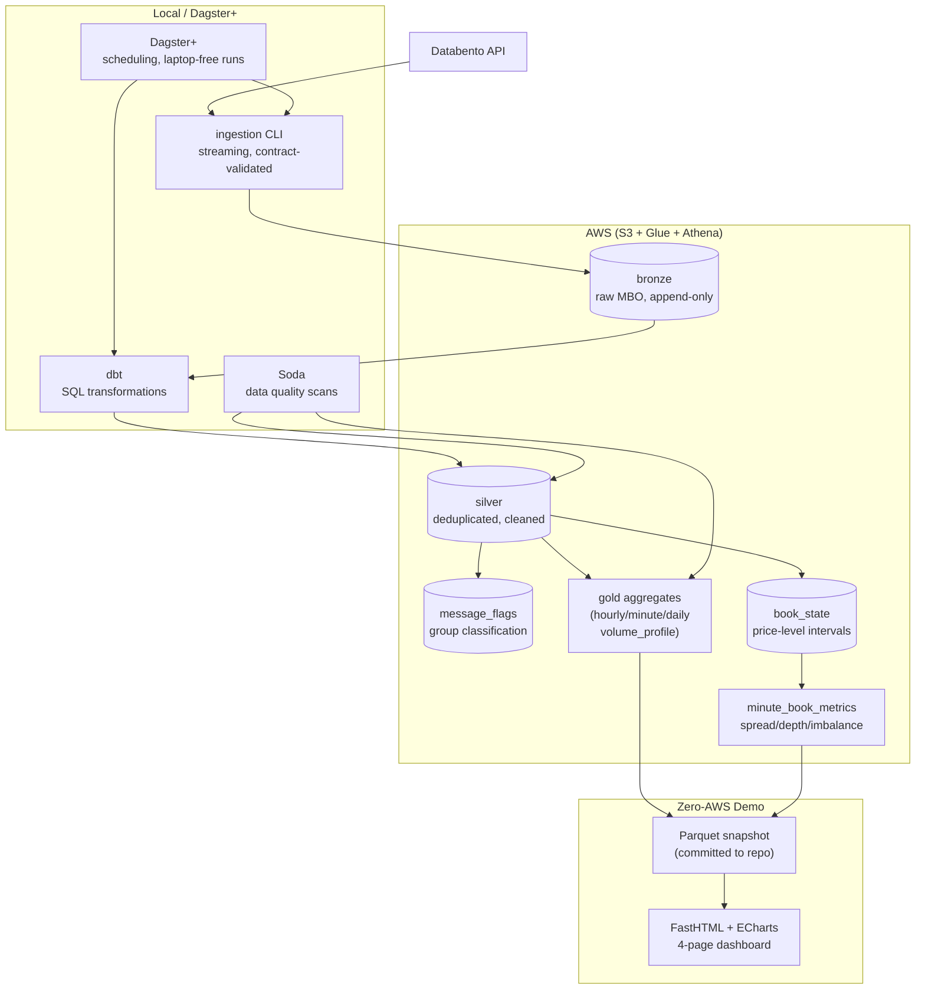
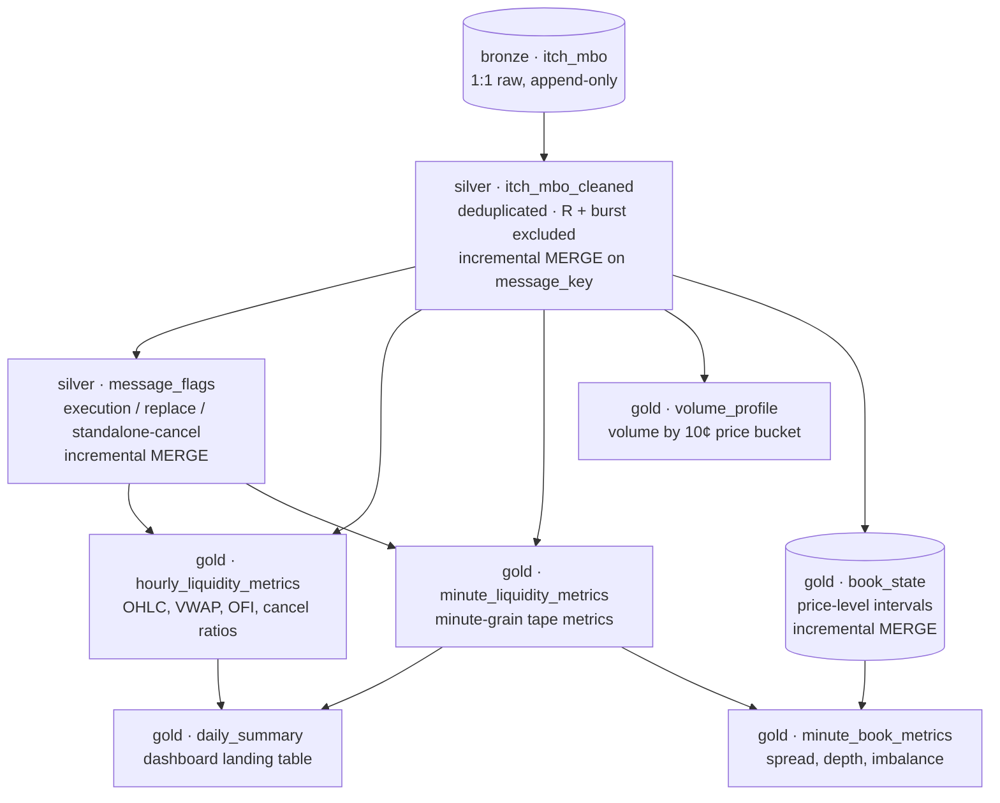

# Market Surveillance

**Nasdaq order-book manipulation detection** — a data engineering pipeline that ingests market-by-order data, reconstructs the displayed order book, and surfaces surveillance indicators for spoofing, layering, and marking the close.

[](https://market-surveillance-analysis.onrender.com/)
[]()
[]()
[]()

**Live demo**: [market-surveillance-analysis.onrender.com](https://market-surveillance-analysis.onrender.com/) — four pages: market overview, three manipulation lenses, methodology, and pipeline monitoring.

---

## What it does

```
Databento API → streaming ingestion → Iceberg bronze (raw)
                                        ↓
              dedup + synthetic-exclusion → Iceberg silver (cleaned)
                                        ↓
         verified message semantics → message_flags (classification)
                                        ↓
      ┌────────────────────────────────┴──────────────────┐
      ↓                                                  ↓
  gold aggregates                              book replay (price-level
  (OHLC, VWAP, OFI, cancel ratios,           intervals → spread, depth,
   large orders, vol profile, lifetimes)      imbalance, 96-99% validated)
      └────────────────────────────────┬──────────────────┘
                                       ↓
                            demo dashboard (4 pages)
```

Every metric rests on **empirically verified feed semantics** — not documentation claims, but rules proven against the actual data with SQL queries. The order book is reconstructed from price-level intervals and validated to the touch (95–99% of prints land exactly on the reconstructed best bid/ask).

## Architecture



## Repository structure

```
market-surveillance/
├── src/
│   ├── ingestion/          # Databento → bronze (streaming, idempotent)
│   │   ├── ingest.py       #   CLI: --start/--end or 5-day catch-up
│   │   ├── extractor.py    #   Range-job planning, concurrent submission
│   │   ├── converter.py    #   DBN → Arrow (contract-validated chunks)
│   │   └── iceberg_sink.py #   PyIceberg append with lineage stamps
│   ├── observability/      # Soda data quality (3 planes)
│   │   ├── ingest_checks.py#   Payload gate (fail-closed, pyarrow)
│   │   ├── scan.py         #   Silver + gold Athena scans (CLI)
│   │   └── checks/         #   SodaCL YAML (schema + value + reconciliation)
│   └── export/
│       └── gold_snapshot.py# Athena UNLOAD → Parquet for the demo
├── dbt/
│   ├── models/
│   │   ├── silver/         # itch_mbo_cleaned, message_flags
│   │   └── gold/           # 6 aggregate + book models
│   ├── tests/              # 4 singular invariant tests
│   ├── dbt_project.yml     # folder → schema/materialization mapping
│   └── profiles.yml        # Athena connection (no secrets committed)
├── orchestration/          # Dagster project (laptop-free pipeline)
│   ├── assets.py           # 4 assets: bronze/silver/gold/soda
│   ├── resources.py        # PipelineConfig, AwsConfig, DbtConfig
│   └── schedules.py        # Weekday catch-up schedule
├── demo/                   # Zero-AWS dashboard
│   ├── app.py              # FastHTML + ECharts (4 pages)
│   ├── data/               # Parquet snapshot (committed, ~1 MB)
│   ├── powerbi-data/       # CSVs + PROMPT.md for Power BI Desktop
│   └── Dockerfile          # Deploy anywhere (Render, Fly.io, etc.)
├── knowledge-base/         # The thinking framework (7 docs + evidence)
│   ├── 01-market-fundamentals.md
│   ├── 02-dataset-and-events.md
│   ├── 03-metrics-and-indicators.md
│   ├── 04-data-lineage.md
│   ├── 05-analytical-decisions.md
│   ├── 06-surveillance-mindmap.md
│   ├── 07-diagrams.md
│   └── prototype-evidence/ # The validation SQL + results
├── infra/                  # Terraform (bucket, Glue, Athena workgroup)
├── dagster_cloud.yaml      # Dagster+ Serverless code location
└── CLAUDE.md               # AI assistant instructions + data contract
```

## Data modeling

### dbt models and lineage

Nine models across three layers, managed by dbt and materialized as Iceberg tables on Athena:



### Silver models

**`itch_mbo_cleaned`** — the cleaned message stream, 1:1 with bronze minus two classes of Databento synthetic bookkeeping (R book-clear records and the day-boundary cleanup burst), deduplicated on a null-safe md5 surrogate key. Incremental merge with a dual-mode window: 5-day rolling catch-up by default, or explicit `start_date`/`end_date` vars for backfilling any range idempotently.

**`message_flags`** — one row per message, classifying each by its message group's contents: `in_execution_group`, `in_replace_group`, `in_cancel_group`, `is_standalone_cancel`. This is the vocabulary every surveillance metric is written in — a *standalone cancel* (no execution, no replace in its group) is the only cancel a human or algorithm deliberately chose.

### Gold models

| Model | Grain | What it answers |
|---|---|---|
| `hourly_liquidity_metrics` | (symbol, day, hour) | What did the market look like? — OHLC, VWAP, volume, OFI, cancel ratios |
| `minute_liquidity_metrics` | (symbol, day, minute) | Time-weighted questions — burst detection, TWAP, realized vol, chart bars |
| `daily_summary` | (symbol, day) | The day at a glance — all headline metrics, large-order screen, close premium |
| `volume_profile` | (symbol, day, price bucket) | Where did trading concentrate? — volume-at-price distribution |
| `book_state` | (symbol, day, side, price) | The replay engine — price-level intervals reconstructing the displayed book |
| `minute_book_metrics` | (symbol, day, minute) | What liquidity was offered? — spread, depth, imbalance at the touch |

### The book replay (Phase 3)

The displayed order book is reconstructed from **price-level intervals**: for each `(side, price)` level, a running sum of adds minus cancels ordered by `sequence` (never by timestamp — a trade and its book update share identical `ts_event`). One interval row per live level state, from one event to the level's next event. This representation reconstructs the book at any instant without storing a per-message copy.

**Validated to the touch**: 95.7% of buy prints and 99.0% of sell prints land exactly at the reconstructed best bid/ask at the event instant (a deliberately wrong book scores 2.3%). Evidence: [`knowledge-base/prototype-evidence/`](knowledge-base/prototype-evidence/).

### Verified semantics (the foundation)

Every rule below was tested against the actual feed — not taken from documentation:

| Rule | Verification |
|---|---|
| Executions are T+F+C groups; only C mutates book state | C.size = F.size in 27,350/27,350 groups |
| T carries the aggressor's side | 95.7%/99.0% of prints at the touch (event-instant) |
| Replaces are C+A pairs | 54,624 groups on a single day |
| "Standalone cancel" = no execution, no replace in group | The numerator of every surveillance ratio |
| Nasdaq's "start-of-day snapshot" = one R row (not re-injected adds) | Measured: zero messages in 5 min after R |
| Day-boundary cleanup burst (AAPL only) breaks sequence↔time ordering | Found via 1,425 crossed quotes; excluded in silver |
| Zero M rows exist; modifies manifest as C+A | Action mix across all inspected days |

### Tests and quality gates

| Plane | Tool | What it checks |
|---|---|---|
| **Payload** (ingestion) | pyarrow checks, fail-closed | Action/side domains, price completeness, size validity |
| **Build-time** | 38 dbt tests | Not-null keys, accepted values, replay invariants (non-negative, no inversions) |
| **Post-build** | 28 Soda checks | Schema contracts, value domains, cross-layer reconciliation |

The Soda plane is independent of dbt's code path — a broken build that passes dbt tests can still fail the Soda reconciliation (defense in depth).

## Replication guide

### Prerequisites

- Python 3.13+ with [`uv`](https://docs.astral.sh/uv/)
- AWS account (free tier works; idle cost < $1/month)
- Databento account with API key ([free trial includes credits](https://databento.com))
- Terraform (for infrastructure; one-time setup)
- Optional: Dagster+ account for laptop-free orchestration

### Step 1 — Infrastructure (one-time)

```bash
cd infra
terraform init
terraform apply
```

Creates: S3 bucket (`trading-surveillance-data`), Glue databases (one per layer), Athena workgroup. See `infra/main.tf` for details.

### Step 2 — Environment

```bash
# Clone and install
git clone https://github.com/nbaubek/market-surveillance-analysis.git
cd market-surveillance-analysis
uv sync

# Configure credentials
export AWS_PROFILE=my-dev-profile        # or set AWS_ACCESS_KEY_ID etc.
echo "DATABENTO_API_KEY=your_key" > .env
```

### Step 3 — Ingest data into bronze

```bash
# Check cost first (free API call)
uv run --env-file .env python -c "
from src.ingestion.client import DatabentoClient
from src.ingestion.spec import ExtractSpec
c = DatabentoClient()
print(c.estimate_cost(ExtractSpec(symbols=['MSFT'], start='2019-07-30', end='2019-08-10')))
"

# Ingest a range (idempotent: already-ingested days are skipped)
uv run --env-file .env python -m src.ingestion.ingest \
  --symbols MSFT --symbols AAPL \
  --start 2019-07-30 --end 2019-08-10
```

The extractor plans concurrent range jobs per symbol — Databento processes them in parallel, so the wall-clock is one queue round-trip deep, not one per day.

### Step 4 — Transform (dbt)

```bash
cd dbt

# Build silver + flags for the ingested range (end date inclusive)
AWS_PROFILE=my-dev-profile uv run dbt run \
  --select itch_mbo_cleaned message_flags book_state \
  --vars '{"start_date": "2019-07-30", "end_date": "2019-08-09"}'

# Build all gold models (full rebuild — tiny outputs)
AWS_PROFILE=my-dev-profile uv run dbt run

# Verify
AWS_PROFILE=my-dev-profile uv run dbt test
```

### Step 5 — Data quality (Soda)

```bash
cd ..  # repo root

# Silver: 14 checks (schema contract, exclusions, key integrity)
AWS_PROFILE=my-dev-profile uv run --no-project \
  --with soda-core-athena --with setuptools \
  python src/observability/scan.py silver

# Gold: 22 checks (reconciliation, book invariants, vwap sanity)
AWS_PROFILE=my-dev-profile uv run --no-project \
  --with soda-core-athena --with setuptools \
  python src/observability/scan.py gold
```

### Step 6 — Run the demo

```bash
# Export gold tables → Parquet snapshot (committed to demo/data/)
AWS_PROFILE=my-dev-profile uv run python -m src.export.gold_snapshot

# Run locally
cd demo
uv sync
uv run python app.py          # → http://localhost:7860
```

**Deploy**: the `demo/Dockerfile` works on Render, Fly.io, Railway, or any container platform. The app reads only the committed Parquet files — zero AWS dependency at runtime.

### Step 7 — Orchestrate (optional, Dagster+)

```bash
# Local development
export AWS_PROFILE=my-dev-profile
uv run dagster dev             # → http://localhost:3000

# Deploy to Dagster+ Serverless
# 1. Sign up at dagster.io → Serverless deployment
# 2. Connect GitHub repo (dagster_cloud.yaml is already committed)
# 3. Set env vars: DATABENTO_API_KEY, AWS keys, INGEST_SYMBOLS
# 4. Deploy — weekday schedule fires at 06:00 UTC on Dagster's compute
```

### Scaling to more data

The pipeline scales linearly. Rough costs (Databento, per trading day per symbol):

| Symbol type | Cost/day | Rows/day | Notes |
|---|---|---|---|
| Large cap (MSFT, AAPL) | $0.15–0.30 | 2–3M | Heaviest books |
| Mid cap (TSLA, MU) | $0.20–0.45 | 3–5M | TSLA ≈ AAPL-class activity |
| Small cap (ROKU, TTD) | $0.02–0.05 | 0.3–0.8M | Cheap, still meaningful |

**One month × 6 symbols ≈ $20–40 and ~4–8 hours** (mostly Databento batch-processing wall-clock; submit one range job per symbol and they process concurrently).

## Demo

**Live**: [market-surveillance-analysis.onrender.com](https://market-surveillance-analysis.onrender.com/)

| Page | What it shows |
|---|---|
| **Overview** | KPI tiles, price vs VWAP, aggressor flow, intraday volatility, volume profile, day panel with distribution strips |
| **Surveillance** | Three manipulation lenses: spoofing (large-order cancels + lifetimes), layering (book imbalance + depth), marking the close (late OFI + premium) |
| **Methodology** | The project's thinking framework — searchable, in plain language |
| **Monitor** | Pipeline observability: Iceberg snapshot lineage, ingestion coverage, Soda scan results |

**Power BI twin**: [`demo/powerbi-data/`](demo/powerbi-data/) contains CSV exports + `PROMPT.md` (a complete build specification for Claude Code on a Windows machine with Power BI Desktop).

## Tech stack

| Layer | Technology | Why |
|---|---|---|
| Ingestion | Python, Databento SDK, PyIceberg | Streaming, contract-validated, memory-bounded |
| Storage | Apache Iceberg on S3 + Glue | ACID, hidden partitioning, snapshot lineage |
| Transformation | dbt + dbt-athena (Athena SQL) | Declarative, tested, documented |
| Query engine | AWS Athena (Trino) | Serverless, pay-per-scan |
| Data quality | Soda Core (ephemeral env) | Independent verification plane |
| Orchestration | Dagster / Dagster+ | Daily partitions, laptop-free execution |
| Dashboard | FastHTML + MonsterUI + ECharts + DuckDB | Zero-AWS, full design control |
| Infrastructure | Terraform | Reproducible, one-command setup |
| Alternative BI | Power BI Desktop | Import mode from CSVs, portfolio twin |

## Key design decisions

See [`knowledge-base/05-analytical-decisions.md`](knowledge-base/05-analytical-decisions.md) for the full decision log with rejected alternatives. The short version:

- **Iceberg over raw Parquet/S3**: ACID commits, snapshot lineage (free ingestion audit), hidden partitioning, time travel for debugging.
- **Merge over append (silver)**: idempotent re-processing of any date range; no high-water mark to break on backfills.
- **Price-level replay over per-order**: expressible in one SQL window pass, incremental, validated — per-order deferred until an order-level metric justifies it.
- **Full rebuild (gold)**: outputs are tiny; recomputation is trivially correct — no merge keys, no window alignment, no double-count class of bugs.
- **Zero-AWS demo**: dashboard reads committed Parquet files; no credentials, no trial-clock dependency, deployable anywhere.
- **Dagster+ over Lambda**: 15-min cap vs multi-minute ingestion; container packaging for PyIceberg; native scheduling and sensors without EventBridge glue.

## Known limitations

- **Single venue** (Nasdaq) — cross-market manipulation invisible
- **Displayed size only** — hidden/iceberg liquidity unmeasured
- **Anonymous participants** — wash trading out of scope by design
- **Conduct ≠ intent** — every indicator is a signal to investigate, never proof

## Further reading

- [`knowledge-base/`](knowledge-base/) — the full thinking framework (market fundamentals, verified semantics, every metric's formula/interpretation/limits, lineage, decision log, surveillance mindmap, concept diagrams, validation evidence)
- [`knowledge-base/03-metrics-and-indicators.md`](knowledge-base/03-metrics-and-indicators.md) — compact technical metric catalog
- [`knowledge-base/02-dataset-and-events.md`](knowledge-base/02-dataset-and-events.md) — engineering plan with phase history and open questions
- [`dataset-info.md`](dataset-info.md) — Databento XNAS.ITCH normalization reference
- [`iceberg-maintain-queries.md`](iceberg-maintain-queries.md) — OPTIMIZE/VACUUM maintenance
