# 07 · Diagrams

Visual companions to docs 01–06. Each diagram says which doc it supports,
so you can either read this page on its own or copy a block into the
matching doc (Mermaid renders natively on GitHub, GitLab and most
Markdown viewers; the order book is a plain SVG).

| # | Diagram | Supports |
|---|---|---|
| 1 | The four questions | README |
| 2 | Order book, spread, aggressor, imbalance | 01, 03 |
| 3 | Order lifecycle | 01 |
| 4 | Message-group anatomy | 02 |
| 5 | "What kind of C is this?" decision tree | 02, 03 |
| 6 | Metric map by market question | 03 |
| 7 | Data lineage | 04 |
| 8 | Replay: how a level's depth is computed | 04 |
| 9 | Strategy → conduct → indicator → alert | 06 |
| 10 | Spoofing as a timeline | 06 |
| 11 | Real interest vs flickering | 06 |

---

## 1 · The four questions (README)

Each question is only credible if the one below it is verified.

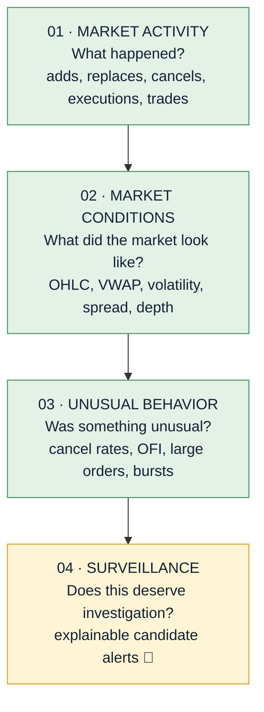

---

## 2 · Order book, spread, aggressor, imbalance (01, 03)

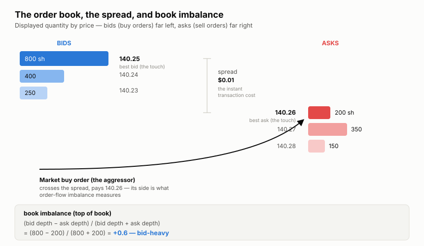

---

## 3 · Order lifecycle (01)

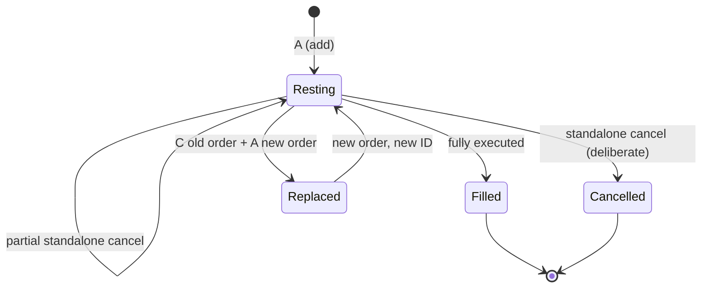

Cancelling is free and instant; the standalone cancel is the "tell" that
surveillance cares about.

---

## 4 · Message-group anatomy (02)

One exchange message produces one **group**, identified by
`(ts_event_day, channel_id, sequence)`. Only `C` and `A` change book
state; `T` and `F` are no-ops.

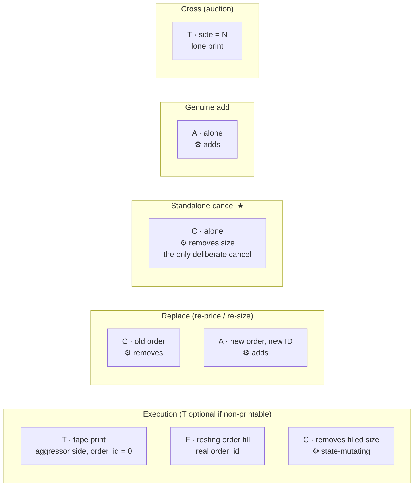

Counting both `T` and `F` double-counts each execution, so volume and trade
counts use **T only**.

---

## 5 · "What kind of C is this?" (02, 03)

This is the logic behind `is_standalone_cancel`, the numerator of every
surveillance ratio.

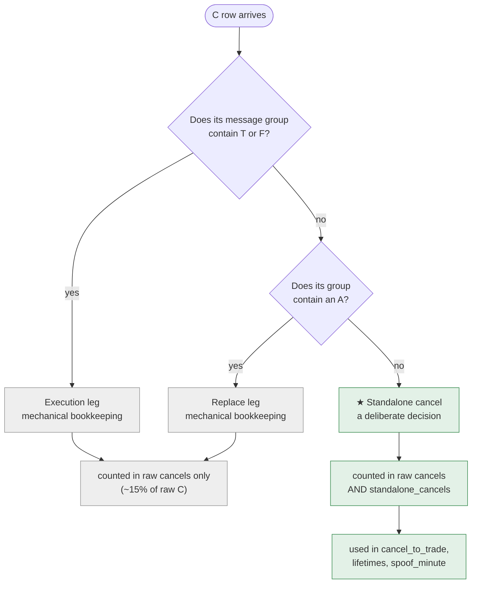

Mirror trap for **A** rows: `in_replace_group` is always true for an A
(its own leg). Use `in_cancel_group` to tell replace-adds from genuine adds.

---

## 6 · Metric map by market question (03)

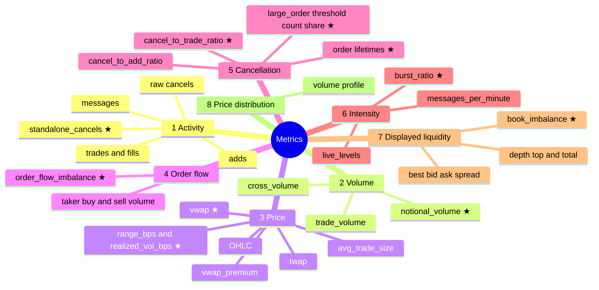

★ = headline metric. Sources: tape metrics come from `T` rows; groups 5, 7
need `message_flags` or `book_state`.

---

## 7 · Data lineage (04)

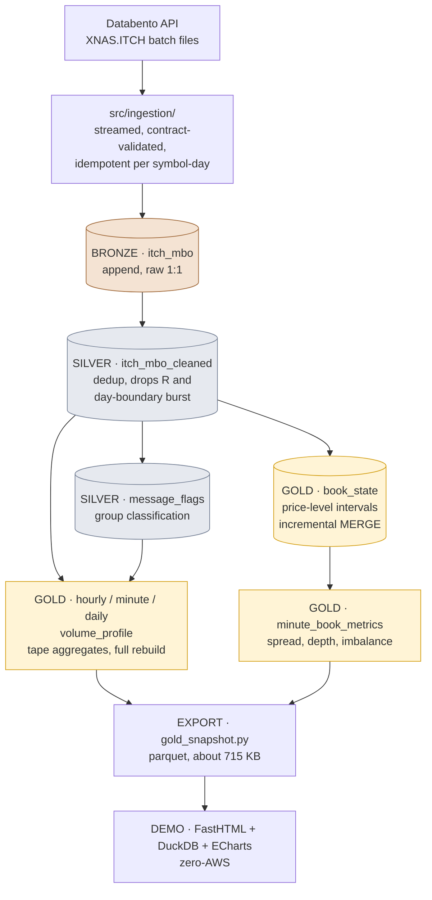

Dashboards read gold only, which is the medallion contract that made the
zero-AWS demo a simple export.

---

## 8 · Replay: from events to depth at a price (04, 05)

Replay works per `(side, price)` level: depth is a running sum of adds
minus cancels, ordered by `sequence` (never timestamp).

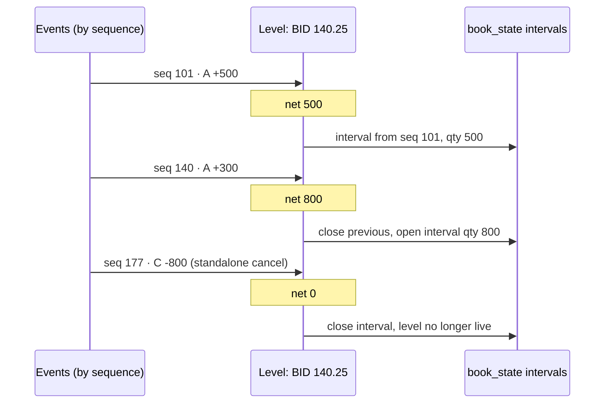

Querying "what was the book at minute M?" means picking the interval that
covers M (`[ts_from, ts_to)`). Pre-trade state at an event uses
`valid_to_seq >= s`. The invariant test recomputes these sums from silver
and asserts they are never negative.

---

## 9 · Strategy → conduct → indicator → alert (06)

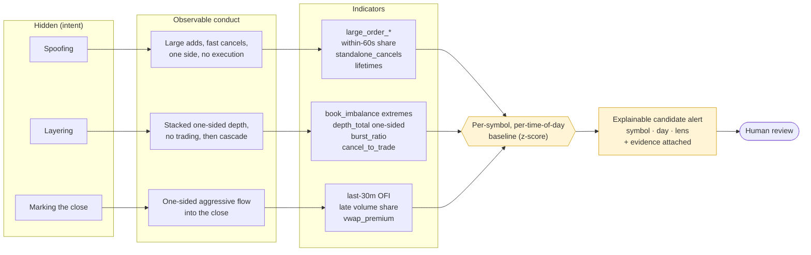

No single indicator is an alert. An alert needs the conjunction of conduct,
one-sidedness and persistence, judged against the symbol's own norms. The
baseline layer (yellow) is the part still to be built.

---

## 10 · Spoofing as a timeline (06)

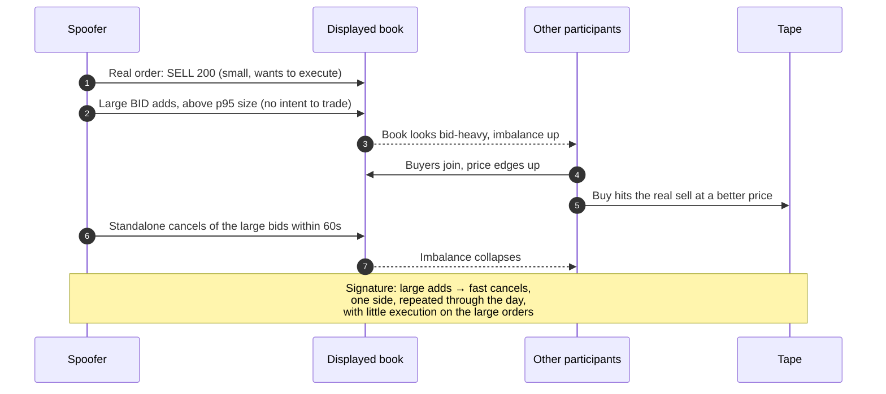

---

## 11 · Real interest vs flickering (06)

How the "honest twin" is told apart from the suspicious pattern.

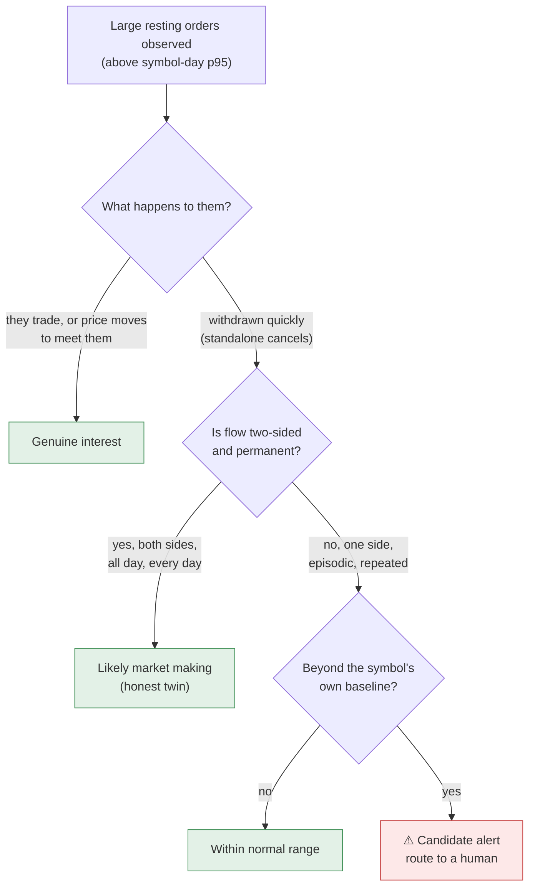

Same shape applies to the other two lenses: layering's honest twin is
genuine large interest that trades, and the close-marking twin is index
rebalancing or MOC imbalance on known dates.
